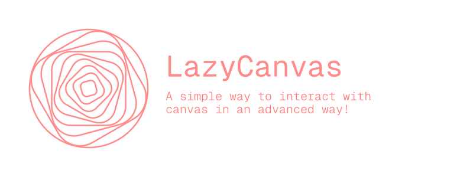

<p align="center">
  
</p>

<p align="center">
  <a href="https://www.npmjs.com/package/@nmmty/lazycanvas"></a>
  <a href="https://www.npmjs.com/package/@nmmty/lazycanvas"></a>
  <a href="https://github.com/NMMTY/LazyCanvas/blob/main/LICENSE"></a>
  <a href="https://deepwiki.com/NMMTY/LazyCanvas"></a>
</p>

# @nmmty/lazycanvas

Declarative 2D canvas rendering with flexbox layout, JSX and signal-based animation. One scene description, rendered the same way on **Node.js**, in the **browser** and in **React**.

- **Layers** — `Morph` (rounded shapes), `Text`, `Image`, `Line`, `Bezier`, `Quadratic`, `Polygon`, `Path2D`, grouped with `Group`.
- **Flexbox layout** — powered by [Yoga](https://www.yogalayout.dev/): `flexDirection`, `gap`, `padding`, `justifyContent`, `alignItems`, absolute positioning and more.
- **JSX** — write scenes as JSX, with the classic or the automatic runtime (`jsxImportSource`).
- **Signals & animation** — `createSignal`, tweens, springs, keyframes, easing, a GSAP-style `timeline()`, `stagger` and generator-based composition (`all`, `chain`, `loop`, `waitFor`, …). Any time can be rendered in any order, so pause, reverse and scrub are just a matter of which time you ask for.
- **Transforms** — `Transform` with an `origin`, skew and `matrix`, `Matrix`/`Vector2` maths, and `layer.worldMatrix()` / `bounds()` / `scene.layerAt()` to find where something is on the canvas.
- **Fast exports** — `bake: true` draws the layers that stay the same once, `scene.frames()` streams frames without keeping them all.
- **Text** — fonts, multiline, letter/word spacing, sub-string colors and vertical writing (`ttb`/`btt`).
- **Export** — PNG, JPEG, WebP and APNG, plus JSON/YAML scene description (Node.js).
- **Adapter based** — the core never touches a concrete canvas; you plug one in.

> Upgrading from 0.6.x? Read the [migration guide](https://docs.hitomihiumi.xyz/docs/migration-from-0.6).

## Installation

LazyCanvas is split into a renderer-agnostic core and an adapter for your environment:

| Environment | Install |
| --- | --- |
| Node.js | `npm install @nmmty/lazycanvas @nmmty/adapter-node` |
| Browser | `npm install @nmmty/lazycanvas @nmmty/adapter-browser` |
| React / Next.js | `npm install @nmmty/lazycanvas @nmmty/adapter-browser @nmmty/adapter-react` |

Requires Node.js 18 or newer. The core ships as ESM and CommonJS with full TypeScript types.

## Quick start (Node.js)

```ts
import { NodeCanvasAdapter } from "@nmmty/adapter-node";
import { Group, Morph, Scene, Text } from "@nmmty/lazycanvas";
import { Exporter } from "@nmmty/lazycanvas/node";

const scene = new Scene(600, 300, { adapter: new NodeCanvasAdapter() });

scene.load(
  new Group({
    layout: { width: 600, height: 300, justifyContent: "center", alignItems: "center" },
  }).add(
    new Morph({
      color: "#7c3aed",
      size: { width: 600, height: 300, radius: { all: 24 } },
      layout: { position: "absolute", top: 0, left: 0 },
    }),
    new Text({
      text: "Hello, LazyCanvas!",
      color: "#ffffff",
      font: { family: "sans-serif", size: 44, weight: 700 },
      align: "center",
    }),
  ),
);

await new Exporter(scene).export("png", { name: "hello", saveAsFile: true });
```

## Quick start (browser)

```ts
import { BrowserCanvasAdapter } from "@nmmty/adapter-browser";
import { Group, Morph, Scene } from "@nmmty/lazycanvas";

const canvas = document.querySelector("canvas")!;
const scene = new Scene(400, 200, { adapter: new BrowserCanvasAdapter(canvas) });

scene.load(
  new Group().add(new Morph({ color: "#22c55e", size: { width: 400, height: 200 } })),
);

await scene.renderFrame(0);
```

For React, see [`@nmmty/adapter-react`](https://github.com/NMMTY/LazyCanvas/tree/main/packages/adapter-react).

## Animation

Layer props accept signals. Animate them from a generator and let the scene drive the timeline:

```ts
import { Group, Easing, Morph, Scene, all, createSignal } from "@nmmty/lazycanvas";

const x = createSignal(20);
const color = createSignal("#ef4444");

const scene = new Scene(300, 100, { adapter });
scene.load(
  new Group().add(
    new Morph({
      position: { x, y: 30 },
      size: { width: 40, height: 40, radius: { all: 8 } },
      color,
    }),
  ),
);

scene.addAnimation(function* () {
  yield* all(x.to(240, 1, { easing: Easing.easeInOutCubic }), color.to("#3b82f6", 1));
});

// Node.js: write an animated PNG
await new Exporter(scene).export("apng", { duration: 1, fps: 30, saveAsFile: true });
// Anywhere: render any point of the timeline yourself
await scene.renderFrame(0.5);
```

## JSX

```tsx
/** @jsxImportSource @nmmty/lazycanvas */
import { Group, Morph, Text } from "@nmmty/lazycanvas";

scene.load(
  <Group layout={{ flexDirection: "row", gap: 12, padding: 16 }}>
    <Morph color="#7c3aed" layout={{ width: 80, height: 80 }} />
    <Text text="JSX" color="#111827" font={{ family: "sans-serif", size: 32, weight: 700 }} align="left" />
  </Group>,
);
```

With the classic runtime use `/** @jsx createElement */` and import `createElement` from `@nmmty/lazycanvas`.

## Entry points

| Import | Contents | Runs in |
| --- | --- | --- |
| `@nmmty/lazycanvas` | `Scene`, layers, signals, layout, types | Node.js, browsers |
| `@nmmty/lazycanvas/node` | `Exporter`, `APNGEncoder`, `readJSONFile`, `readYAMLFile` | Node.js only |
| `@nmmty/lazycanvas/fonts` | Bundled Geist fonts (~2.7 MB, opt-in) | Anywhere |
| `@nmmty/lazycanvas/jsx-runtime` | Automatic JSX runtime | Anywhere |

The main entry point has no Node.js built-ins, so bundlers need no polyfills.

## Bundlers

Yoga loads its WebAssembly with a top-level `await`. esbuild (ESM output) handles that out of the box; with Vite set `build.target: "esnext"`; for webpack (including Next.js) enable it explicitly:

```js
// next.config.mjs
export default {
  transpilePackages: ["@nmmty/lazycanvas", "@nmmty/adapter-browser", "@nmmty/adapter-react"],
  webpack: (config) => {
    config.experiments = { ...config.experiments, topLevelAwait: true };
    config.output.environment = { ...config.output.environment, asyncFunction: true };
    return config;
  },
};
```

## Fonts

On Node.js, register fonts from files or load the bundled Geist family:

```ts
import { Fonts } from "@nmmty/lazycanvas/fonts";

scene.lazyCanvas.manager.fonts.loadFonts(Fonts);
```

In the browser, declare families with CSS `@font-face` and refer to them by name; the browser adapter makes sure they are loaded before the first frame. To bundle your own fonts as base64, see [Your own fonts as base64](https://docs.hitomihiumi.xyz/docs/text#your-own-fonts-as-base64).

## Documentation

- [Guides and API reference](https://docs.hitomihiumi.xyz/docs/introduction)
- [Animation](https://docs.hitomihiumi.xyz/docs/animation) and [Performance](https://docs.hitomihiumi.xyz/docs/performance)
- [Migration guide: 0.6.x → 1.0](https://docs.hitomihiumi.xyz/docs/migration-from-0.6)
- [Changelog](https://github.com/NMMTY/LazyCanvas/blob/main/CHANGELOG.md)

## License

[MIT](./LICENSE) © NMMTY
